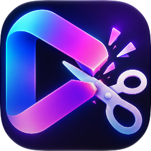
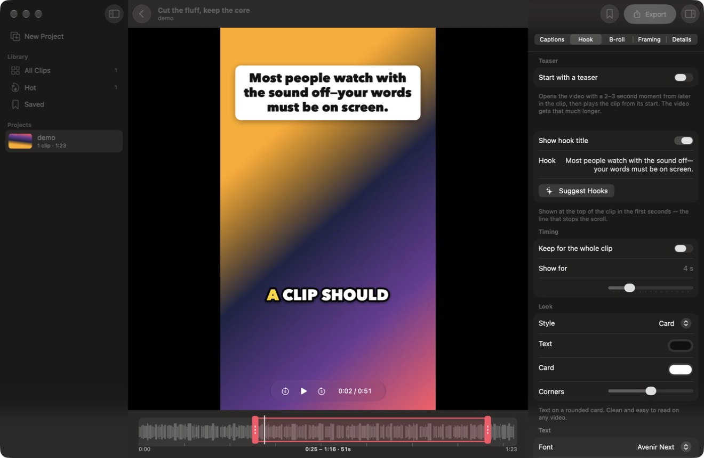
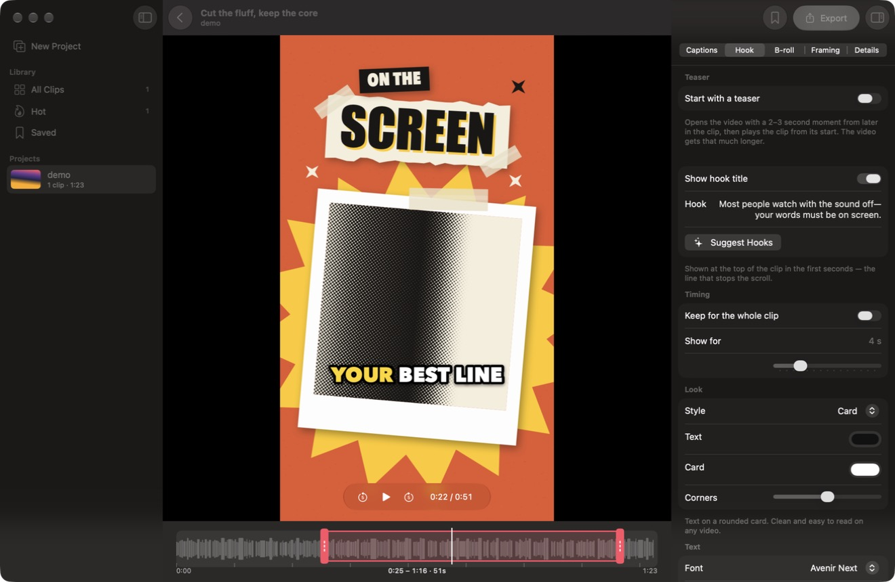
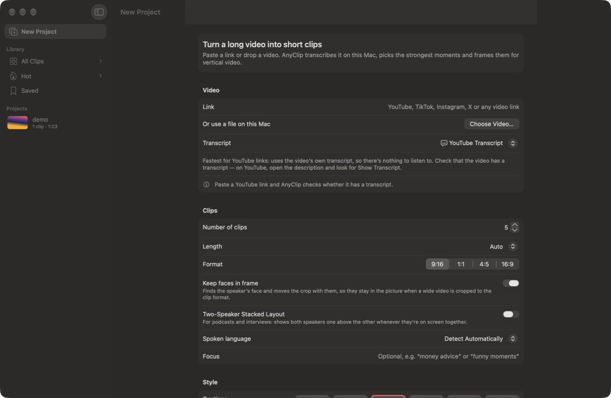

<div align="center">



# AnyClip

**Turn long videos into short vertical clips, right on your Mac.**

Free. No account. No license key. No watermark of ours.


[](LICENSE)



</div>

## What it does

Paste a link or drop in a video. AnyClip transcribes it, finds the moments that work on their own, and frames each one for TikTok, Reels and Shorts, with captions and a hook title ready to edit. It is a native SwiftUI app with no Electron and no server of its own.

## Features

<table>
<tr>
<td width="50%" valign="top">

**🎬 Find the moments**
- Picks self-contained moments with a virality score
- Writes a title, an on-screen hook and a post caption in the video's language
- Ends clips on finished sentences, cut where the voice actually stops

</td>
<td width="50%" valign="top">

**📝 Transcribe your way**
- Apple speech recognition, built in
- YouTube's own transcript, the fastest for YouTube links
- Your SRT or VTT file
- WhisperKit, running offline on this Mac

</td>
</tr>
<tr>
<td valign="top">

**🖼️ Frame every speaker**
- Face tracking keeps the speaker in the crop
- Two-speaker stacked layout for podcasts and interviews
- Manual crop keyframes
- 9:16, 1:1, 4:5 and 16:9

</td>
<td valign="top">

**✨ Make it stop the scroll**
- 6 animated caption styles with word highlighting
- 4 hook title looks
- Cold-open teasers taken from later in the clip
- Animated B-roll keyword cards
- Your own text or logo watermark

</td>
</tr>
<tr>
<td valign="top">

**✂️ Edit and export**
- Trim by word on a speech timeline
- Edit captions directly, with a live preview that matches the export
- H.264 or HEVC, from 720p up to 4K
- Every export comes with its thumbnail: the video's first frame, ready to upload
- Library with search, Hot and Saved clips
- Schedule clips straight to YouTube with Auto Schedule, using each clip's title and caption

</td>
<td valign="top">

**🧠 Choose your AI**
- Apple Intelligence, on this Mac, by default
- Your own key for Gemini, Groq, OpenAI, OpenRouter or Anthropic
- Any OpenAI-compatible server, including local ones
- Built-in scoring when no AI is available

</td>
</tr>
</table>

<div align="center">


</div>

The interface is available in English and Bahasa Indonesia, and follows your system language.

## Getting started

There are no signed releases yet, so AnyClip is built from source for now.

**You need**
- macOS 27 or later
- Xcode 27 or later
- Apple Intelligence is optional. Without it, AnyClip uses built-in scoring.

**Build and run**

```bash
git clone https://github.com/fadhiljr7/AnyClip.git
cd AnyClip
open AnyClip.xcodeproj
```

1. Select the **AnyClip** target, open **Signing & Capabilities**, and choose your own team. You may also need your own bundle identifier.
2. Press **⌘R**. Xcode fetches [WhisperKit](https://github.com/argmaxinc/WhisperKit) by itself.

**Helper tools.** `yt-dlp` and Deno are only used for video links. AnyClip downloads them from their official GitHub releases when first needed and checks them against their published checksums. Files on your Mac don't need them. `ffmpeg` is optional and converts unusual formats: `brew install ffmpeg`.

## Auto-upload to YouTube

Schedule your clips from AnyClip. Each clip goes up as private with a publish time, and YouTube makes it public at that time, even if your Mac is off.

### 1. Connect your account (once)

YouTube requires every app to have a Google client. AnyClip is open source, so you use your own, for free.

1. In [Google Cloud Console](https://console.cloud.google.com/projectcreate), create a project.
2. Enable [YouTube Data API v3](https://console.cloud.google.com/apis/library/youtube.googleapis.com).
3. In [Google Auth Platform](https://console.cloud.google.com/auth/overview), set up the consent screen with the **External** audience. Under [Audience](https://console.cloud.google.com/auth/audience), add the Gmail that owns your channel as a test user.
4. In [Clients](https://console.cloud.google.com/auth/clients), create a client of type **Desktop app** and download its JSON file.
5. In AnyClip, open **Settings › YouTube**, click **Import Client File…** and choose that file.
6. Click **Connect…** and sign in with your channel's account. If Google says the app isn't verified, click **Advanced › Continue**. That's expected, because it's your own client.

Your client and sign-in stay in your Mac's Keychain.

### 2. Schedule your clips

1. Open a project and click the **Upload to YouTube** toolbar button. It's also in the **Project** menu, and on a clip's right-click menu.
2. Under **Auto Schedule**, set when the first video goes out and the gap between videos, in minutes, hours or days. Times use your Mac's time zone in 24-hour format.

   For example, with a first video at `2 Nov 2026, 01:00` and a gap of 1 hour, the second video goes out at `2 Nov 2026, 02:00`.
3. Tick the clips you want, or click **Select All**.
4. Choose the audience, then click **Schedule**.
5. Keep AnyClip open until the uploads finish. Each clip's status appears on its card and in the editor's **Details** tab.

The clip's title becomes the YouTube title, and its caption becomes the description. Clips are rendered again just before upload, so your latest edits are included.

### 3. Add the thumbnail by hand

**The custom thumbnail must be uploaded manually.** Vertical clips become Shorts, and the thumbnail AnyClip sends through YouTube's API doesn't show as the Short's thumbnail.

1. Find the thumbnail in your export folder, next to the video. It's named after the clip's number, such as `01 Thumbnail.jpg`.
2. In [YouTube Studio](https://studio.youtube.com), open **Content › Shorts** and open the video.
3. Under **Thumbnail**, click **Upload file** and choose the image, then save.

YouTube may limit this option to some channels.

### Troubleshooting

| What you see | What to do |
|---|---|
| `Error 403: access_denied` when connecting | Add the Gmail you're signing in with as a test user, under [Audience](https://console.cloud.google.com/auth/audience) |
| AnyClip asks you to connect again | Sign-ins can expire after about 7 days while your Google project is in Testing. Click **Connect…** again. Videos already uploaded still publish. |
| Uploads pause at the daily limit | AnyClip carries on after YouTube's limit resets, as long as it stays open |

## Keyboard shortcuts

| Shortcut | Action |
|---|---|
| `⌘N` | New project |
| `⌘O` | Import a video |
| `⌘E` / `⇧⌘E` | Export the clip / all clips |
| `⌘D` | Add to or remove from Saved |
| `⇧⌘R` | Show the export in Finder |
| `Space` | Play or pause, in the editor |
| `←` / `→` | Move one second, in the editor |
| `I` / `O` | Set the clip's start / end at the playhead |
| `⌥` while dragging a trim handle | Turn off word snapping |

## Privacy

Your videos, transcripts and clips stay on your Mac. There is no AnyClip account, server or analytics.

| Data | Where it goes |
|---|---|
| Videos, transcripts, library | Only on your Mac, in `~/Library/Application Support/AnyClip` |
| Transcripts sent for AI | Only to the provider you chose. With Apple Intelligence, they normally stay on this Mac. |
| API keys | Your macOS Keychain, and only ever sent to that provider |
| YouTube sign-in | Your own Google client and sign-in stay in your macOS Keychain. Clips you schedule go only to your channel. |
| Browser cookies | Off by default. If you turn them on, yt-dlp uses them on this Mac for sign-in to the video site. |

## How it's built

```
AnyClip/
├── Models/    Project and clip data, teasers, B-roll plans, two-speaker layout rules
├── Engine/    Pipeline and export queue (Studio), rendering, AI providers,
│              transcription, face tracking, downloads
└── Views/     SwiftUI screens, the clip editor and onboarding
AnyClipTests/  Swift Testing suite, hosted by the app with a throwaway library
Scripts/       Release script: archive, notarize and package a DMG
```

Native Apple frameworks do the work: **AVFoundation** and **Core Animation** for rendering, so preview and export share one implementation, **Speech** for transcription, **Vision** for faces, **FoundationModels** for on-device AI, and **SwiftData** for the library.

## Contributing

Issues and pull requests are welcome. Before opening a pull request:

```bash
xcodebuild test -scheme AnyClip -destination 'platform=macOS'
```

- Add tests for behavior changes. The test suite uses an in-memory library, so it never touches your own.
- Every new interface string needs an Indonesian translation in `AnyClip/Localizable.xcstrings`.
- Follow Apple's Human Interface Guidelines, and keep the code free of compiler warnings.
- Never commit API keys or signing files.

## Responsible use

AnyClip is a tool for your own videos and for content you have the right to use. You are responsible for respecting copyright and each site's terms of service. AnyClip is not affiliated with YouTube, TikTok, Instagram or any other platform or AI provider it works with.

## License

AnyClip is free software under the [GNU General Public License v3.0](LICENSE).

## Thanks to

[yt-dlp](https://github.com/yt-dlp/yt-dlp) · [Deno](https://github.com/denoland/deno) · [WhisperKit](https://github.com/argmaxinc/WhisperKit) · [FFmpeg](https://ffmpeg.org)
